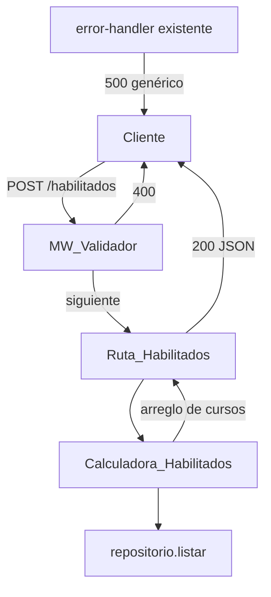

# Design Document

## Overview

Se agrega el endpoint `POST /habilitados` a la aplicación Express existente. El endpoint recibe un arreglo de códigos de cursos aprobados, valida la entrada mediante un middleware dedicado, y delega el cálculo a una función pura (`calcularHabilitados`). El repositorio existente (`src/data/repositorio.js`) provee el catálogo en memoria.

La lógica central es:

> Cursos habilitados = todos los cursos del catálogo cuyos `prerequisites` son un subconjunto de `Aprobados`, excluyendo los cursos que ya están en `Aprobados`, en el orden en que aparecen en `cursos.json`.

## Architecture



La arquitectura sigue el mismo patrón que `GET /cursos`:

- El router de Express se monta en `src/app.js`.
- El middleware de validación se extrae a su propio módulo para ser testeable de forma independiente.
- La función pura `calcularHabilitados` vive en `src/util/` para facilitar pruebas unitarias sin dependencia de HTTP.
- El `error-handler` existente en `src/middleware/error-handler.js` maneja los errores no controlados (Requirement 3.2).

## Components and Interfaces

### 1. Middleware: `src/middleware/validar-habilitados.js`

Responsabilidad: rechazar peticiones que no cumplan el esquema esperado antes de que lleguen a la ruta.

```javascript
// Firma esperada
function validarHabilitados(req, res, next) { ... }
```

Validaciones en orden:
1. `req.body.aprobados` existe y es un arreglo (`Array.isArray`). Si no, → 400 `{ "error": "aprobados debe ser un arreglo de strings" }`.
2. Cada elemento del arreglo es un string. Si no, → 400 `{ "error": "todos los elementos de aprobados deben ser strings" }`.
3. La longitud del arreglo no supera 5000. Si supera, → 400 `{ "error": "aprobados no puede contener más de 5000 elementos" }`.
4. Cada elemento cumple el patrón `^[0-9A-Z]{4,12}$`. Si no, → 400 `{ "error": "formato de código inválido en aprobados", "index": N }` sin reflejar el valor del elemento.

### 2. Función pura: `src/util/calcular-habilitados.js`

```javascript
// Firma
function calcularHabilitados(cursos, aprobados) {
  // cursos: array de objetos { id, prerequisites, ... } (resultado de repositorio.listar())
  // aprobados: array de strings (ya validados y potencialmente con duplicados)
  // retorna: array de objetos curso
}
```

Algoritmo:

```
aprobadosSet = new Set(aprobados)      // deduplicación + O(1) lookup
return cursos.filter(curso =>
  !aprobadosSet.has(curso.id) &&
  curso.prerequisites.every(req => aprobadosSet.has(req))
)
```

La deduplicación mediante `Set` es la implementación de la decisión explícita de idempotencia (ver sección Decisiones). El orden de los resultados es el orden de `cursos` (decisión de orden determinista).

### 3. Ruta: ampliación de `src/routes/cursos.js`

Se agrega el handler `POST /habilitados` al router existente:

```javascript
router.post('/habilitados', validarHabilitados, (req, res) => {
  const cursos = repositorio.listar();
  const resultado = calcularHabilitados(cursos, req.body.aprobados);
  res.json(resultado);
});
```

No se crea un router nuevo; se reutiliza el router de `/cursos` y el endpoint queda en `POST /cursos/habilitados`. Si el enunciado exige montarlo en `/habilitados` (raíz), se agrega `app.use('/habilitados', require('./routes/habilitados'))` en `src/app.js` como alternativa. La decisión de ruta exacta queda documentada en la sección de Decisiones.

> **Decisión de mount point**: el endpoint se expone como `POST /habilitados` (raíz), agregando un archivo `src/routes/habilitados.js` y montándolo en `src/app.js` con `app.use('/habilitados', require('./routes/habilitados'))`. Esto coincide con el enunciado funcional y evita cambios a `cursos.js`.

## Data Models

### Request body

```json
{
  "aprobados": ["1INF25", "1INF27", "1INF49"]
}
```

| Campo | Tipo | Restricciones |
|-------|------|---------------|
| `aprobados` | `string[]` | array; máx 5000 elementos; cada elemento cumple `^[0-9A-Z]{4,12}$` |

### Response body (200)

Arreglo de objetos curso tal como los devuelve `repositorio.listar()`:

```json
[
  {
    "id": "1INF30",
    "name": "Nombre del curso",
    "credits": 4.0,
    "cycle": 5,
    "type": "obligatorio",
    "prerequisites": ["1INF25"]
  }
]
```

### Response body (400)

```json
{ "error": "mensaje descriptivo" }
```

El campo `error` nunca repite el contenido malicioso recibido.

## Security Gates

| Gate | Herramienta y umbral | Bloquea | Etapa | Razón |
|------|----------------------|---------|-------|-------|
| SCA (análisis de composición de software) | `npm audit --audit-level=high` — falla si existe al menos una vulnerabilidad de severidad **high** o **critical** en las dependencias | Sí | Pull request y push a `main` | Detecta dependencias con CVEs de alto impacto antes de que lleguen a producción; el umbral `high` evita ruido de vulnerabilidades de baja severidad irrelevantes para el contexto. |
| Detección de secretos | `gitleaks detect` — umbral cero hallazgos (falla ante cualquier hallazgo) | Sí | Pull request y push a `main` | Previene la publicación accidental de tokens, contraseñas o claves en el repositorio; el umbral cero es el estándar de la industria para este tipo de gate porque un solo secreto expuesto puede comprometer toda la infraestructura. |

## Decisions

### D1: Deduplicación de códigos repetidos en `aprobados`

**Decisión**: el Validador no rechaza duplicados; la `Calculadora_Habilitados` convierte `aprobados` en un `Set` antes de cualquier verificación.

**Razón**: garantiza idempotencia — `POST /habilitados` con `["1INF25","1INF25"]` devuelve exactamente el mismo resultado que con `["1INF25"]`. Simplifica el contrato: el consumidor no necesita deduplicar antes de llamar al servicio. El costo de crear un `Set` es O(n), aceptable dentro del límite de 5000 elementos.

### D2: Orden del arreglo de habilitados

**Decisión**: los cursos se devuelven en el mismo orden en que aparecen en `data/cursos.json` (es decir, el orden de iteración del Map en `repositorio.listar()`).

**Razón**: produce resultados deterministas y comparables entre ejecuciones. Coincide con el orden que ya usa `GET /cursos`, lo que hace la API predecible para el consumidor. No se requiere un paso de ordenación adicional.

### D3: Mount point del endpoint

**Decisión**: el endpoint se monta como `POST /habilitados` (raíz), en un archivo de rutas nuevo `src/routes/habilitados.js`, registrado en `src/app.js`.

**Razón**: coincide literalmente con el enunciado funcional. Mantiene `src/routes/cursos.js` sin modificaciones que rompan los tests existentes.

### D4: Patrón de código aceptado

**Decisión**: `^[0-9A-Z]{4,12}$` (solo dígitos y letras mayúsculas, entre 4 y 12 caracteres).

**Razón**: todos los códigos del catálogo (`1INF25`, `1GES92`, etc.) cumplen este patrón. Rechaza caracteres HTML, rutas de archivo, null bytes y otros vectores de inyección sin ser demasiado restrictivo.

## Correctness Properties

*A property is a characteristic or behavior that should hold true across all valid executions of a system — essentially, a formal statement about what the system should do. Properties serve as the bridge between human-readable specifications and machine-verifiable correctness guarantees.*

### Property 1: Corrección del cálculo de habilitados (modelo de referencia)

*Para cualquier* catálogo de cursos y cualquier subconjunto de códigos aprobados válido, `calcularHabilitados(cursos, aprobados)` devuelve exactamente el mismo conjunto que el modelo de referencia:
`cursos.filter(c => !aprobadosSet.has(c.id) && c.prerequisites.every(r => aprobadosSet.has(r)))`.

**Validates: Requirements 1.1, 1.2, 1.3**

### Property 2: Orden determinista de la respuesta

*Para cualquier* lista de aprobados, los cursos habilitados devueltos aparecen en el mismo orden relativo en que aparecen en el catálogo (subsecuencia de índices crecientes).

**Validates: Requirements 1.4**

### Property 3: Idempotencia ante repetidos en aprobados

*Para cualquier* lista de aprobados con duplicados arbitrarios, `calcularHabilitados(cursos, aprobados)` produce un resultado idéntico al de `calcularHabilitados(cursos, [...new Set(aprobados)])`.

**Validates: Requirements 1.5**

### Property 4: Rechazo de formatos de código inválidos

*Para cualquier* elemento del arreglo `aprobados` que no cumpla `^[0-9A-Z]{4,12}$`, el Validador responde 400 y el mensaje de error no contiene el valor del elemento inválido.

**Validates: Requirements 3.1, 3.3**

## Error Handling

| Condición | Código | Cuerpo |
|-----------|--------|--------|
| `aprobados` falta o no es arreglo | 400 | `{ "error": "aprobados debe ser un arreglo de strings" }` |
| Elemento del arreglo no es string | 400 | `{ "error": "todos los elementos de aprobados deben ser strings" }` |
| Más de 5000 elementos | 400 | `{ "error": "aprobados no puede contener más de 5000 elementos" }` |
| Elemento con formato inválido | 400 | `{ "error": "formato de código inválido en aprobados", "index": N }` |
| Error no controlado (ej. falla del repositorio) | 500 | `{ "error": "Error interno del servidor" }` (manejado por `error-handler` existente) |

El campo `error` nunca incluye el valor del input recibido, stack traces ni rutas del sistema de archivos.

## Testing Strategy

**Enfoque dual: pruebas de ejemplo + pruebas de propiedad**

La función `calcularHabilitados` es una función pura con un espacio de entrada amplio (cualquier catálogo × cualquier subconjunto de aprobados). Las Propiedades 1–3 son candidatas naturales a pruebas de propiedad porque el comportamiento varía significativamente con la entrada y 100 iteraciones pueden descubrir casos límite (cursos sin requisitos, cursos con todos los requisitos aprobados, aprobados con toda la malla, aprobados vacío).

La Propiedad 4 y los requisitos de tipo incorrecto son más apropiados como pruebas de ejemplo porque el espacio de tipos inválidos es finito y representativo.

**Librería de pruebas de propiedad**: `fast-check` (compatible con Jest; disponible como devDependency).

**Configuración mínima**: 100 iteraciones por prueba de propiedad (`numRuns: 100`).

**Tag de trazabilidad**: cada test de propiedad se anota con un comentario `// Feature: habilitados, Property N: <texto>`.

**Cobertura**: ejecutar con `jest --coverage` y validar que la cobertura de líneas de `src/middleware/validar-habilitados.js`, `src/util/calcular-habilitados.js` y `src/routes/habilitados.js` sea ≥ 80% (Requirement 5.1). El gate de CI bloquea la PR si no se alcanza el umbral.

**Pruebas unitarias de ejemplo** cubren:
- Tipos incorrectos (string, número, objeto, null, booleano como valor de `aprobados`).
- JSON malformado / campo ausente.
- Lista vacía `[]`.
- Exactamente 5001 elementos (rebasa el límite).
- Error interno simulado (mock del repositorio que lanza).
